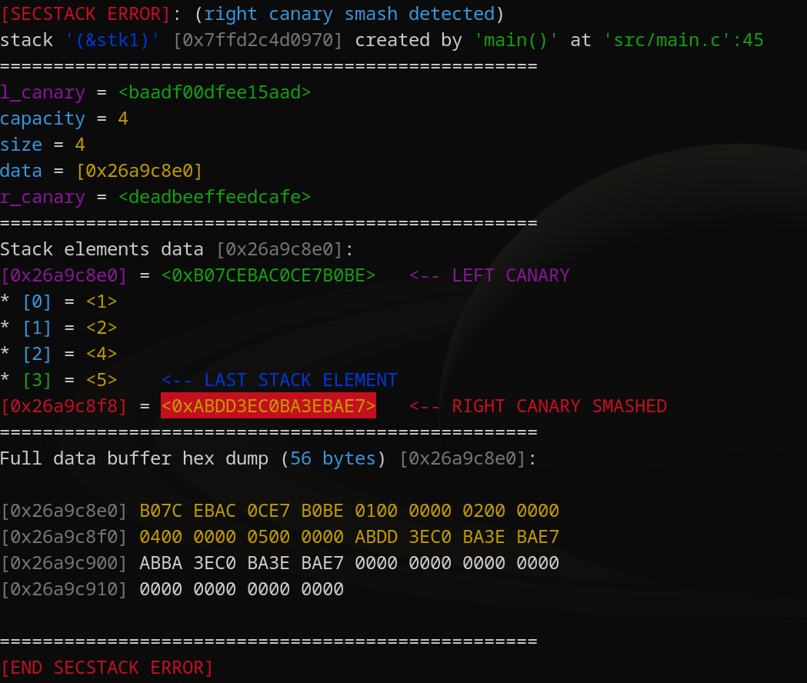

# secstack (secure stack)

## Описание
Данная программа реализует структуру данных стек с канареечной защитой и функциями для отладки.

Библиотека предоставляет тип данных `stack_t` для которого реализованы следующие функции:
* `stack_init`
* `stack_push`
* `stack_pop`
* `stack_pop_n`
* `stack_verify`
* `canary_verify`
* `stack_error_str`
* `stack_destroy`
* `dump_stack`
* `dump_stack_to`

Буффер стека выделяется в куче, его размер автоматически регулируется: если логический размер стека (`size`) достигает размера выделенной под неё памяти (`capacity`), `capacity` вдвоё увеличивается. Если `size` становится меньше или равен четверти `capacity`, `capacity` вдвоё уменьшается.
 

## Верификация стека
При вызове функции, проверяется:
1. Корректность канареек внутри структуры
2. Что указатель на данные стека не `NULL`
3. `size <= capacity`
4. Что указатель на данные стека правильно выравнен
5. Что общий размер стека не больше выделенной под него динамеческой памяти
6. Корректность канареек данных

Пример вывода дампа стека при порче правой канарейки:

## Конфигурация
Имеется возможность конфигурировать стек. В файле `src/config/secstack_config.h` объявлены константы, которые пользователь может менять.

## Компиляция и использование
Для использования достаточно добавить строку `#include src/secstack.h` в своём проекте. Компилировать надо `src/secstack.c`, `src/canary_utils.c`, `dump_funcs.c`.

